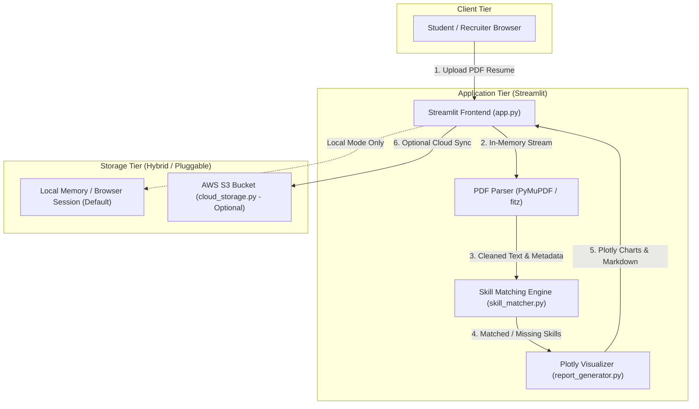

# System Architecture & Cloud Design

## 1. Project Overview
The **Cloud-Based Resume Analyzer** is an automated Applicant Tracking System (ATS) assessment tool developed for an academic **Cloud Computing** course. The solution parses candidate resumes, extracts technical skills, computes role-fit scores, and optionally synchronizes evaluation summaries to cloud storage (**AWS S3**).

---

## 2. Architecture Diagram

---

## 3. Component Breakdown

| Component | Technology | Responsibility |
| :--- | :--- | :--- |
| **User Interface** | `Streamlit` | Interactive dashboard, file upload, role selection, visual metric cards. |
| **PDF Extraction** | `PyMuPDF (fitz)` | Fast, native C-binding parsing of PDF text and structure directly from memory streams. |
| **Skill Matcher** | Pure Python & Regex | Taxonomy-based keyword extraction, regex word boundary checks, ATS score calculation. |
| **Visualization Engine** | `Plotly` | Gauge charts, skill breakdown bars, category distribution charts. |
| **Cloud Storage Client** | `boto3` (AWS SDK) | Optional cloud storage connector to store analysis summaries in AWS S3 buckets. |
| **Unit Testing** | `pytest` | Automated validation of parsing algorithms, scoring math, and edge cases. |

---

## 4. Cloud Computing Concepts Demonstrated

1. **Stateless Processing:**
   - The application does not maintain persistent server session state or a database. Each analysis is stateless, allowing horizontal scaling across containers (e.g. AWS ECS, Docker, or Kubernetes).

2. **Decoupled Cloud Storage (AWS S3):**
   - Resumes and generated reports are decoupled from the compute instance. When enabled, reports are archived as immutable JSON objects in Amazon S3, demonstrating **Object Storage** concepts.

3. **Privacy & Data Protection Principles:**
   - Real candidate resumes are processed strictly in-memory (`io.BytesIO`) and discarded once the HTTP session terminates.
   - Real candidate resumes are never stored permanently, adhering to GDPR/data protection best practices. Only anonymous statistical metadata (skills, score) is synced to cloud storage.

4. **Zero-Lock-in / Graceful Degradation:**
   - If AWS credentials are not configured, the system automatically runs in Local Mode without crashing, demonstrating fault tolerance.
